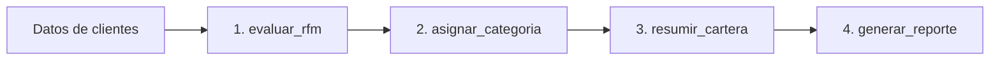

# 🎯 Segmentación de clientes RFM

Proyecto 05 · Bootcamp Data Analyst  
**Autora:** Ala Sushko

Programa en **Python estándar** que clasifica a los clientes de una tienda según su comportamiento de compra para que marketing pueda enviar campañas personalizadas.

---

## 📌 El problema

Marketing envía la misma campaña a todos los clientes. Quiere saber:

- quiénes son los clientes más valiosos,
- quiénes están dejando de comprar,
- y cuánto dinero aporta cada grupo.

## 🗂️ Los datos

8 clientes (datos simulados). De cada uno usamos tres variables, el modelo **RFM**:

| Letra | Variable | Campo |
|:---:|---|---|
| **R** | Recencia: días desde la última compra | `dias_ultima_compra` |
| **F** | Frecuencia: número de compras | `frecuencia_compras` |
| **M** | Valor monetario: dinero gastado | `gasto_total` |

---

## 🪜 Cómo funciona el código, paso a paso

### Paso 1 · `evaluar_rfm(cliente)` → niveles de cada variable

Convierte los números de un cliente en niveles fáciles de leer:

| Variable | Alta / Alto | Media / Medio | Baja / Bajo |
|---|---|---|---|
| Recencia | ≤ 90 días | 91 – 180 días | > 180 días |
| Frecuencia | ≥ 10 compras | 5 – 9 compras | < 5 compras |
| Valor monetario | ≥ 2000 € | 1000 – 1999 € | < 1000 € |

Ejemplo: Ana (5 días, 15 compras, 2400 €) → Recencia **Alta**, Frecuencia **Alta**, Valor **Alto**.

### Paso 2 · `asignar_categoria(evaluacion_rfm)` → categoría del cliente

Combina los tres niveles con `if / elif / else`. Las condiciones se revisan **en este orden**:

| Orden | Categoría | Condición |
|:---:|---|---|
| 1 | 💎 **VIP** | Recencia alta, frecuencia alta y valor alto |
| 2 | 💤 **Inactivo** | Recencia baja (más de 180 días sin comprar) |
| 3 | ⚠️ **En riesgo** | Recencia media (de 91 a 180 días) |
| 4 | 🤝 **Leal** | Recencia alta y frecuencia alta o media |
| 5 | 🌱 **Nuevo** | El resto: compra reciente pero pocas veces |

> [!NOTE]
> La recencia se revisa antes que la frecuencia: un cliente que compraba mucho pero lleva meses sin volver es un **riesgo**, no un cliente leal.

### Paso 3 · `resumir_cartera(clientes)` → resumen por categoría

Recorre a todos los clientes y guarda en un diccionario, por cada categoría:
- cuántos clientes hay,
- cuánto dinero suman,
- y sus nombres.

### Paso 4 · `generar_reporte(clientes)` → reporte final

Calcula el total de ingresos y el **% que aporta cada categoría**, y muestra el resultado en pantalla.



---

## 📊 Resultado

```text
VIP: 2 clientes | 5600.0 € | 57.2 %
  - Ana Silva
  - Sofia Lara
Leal: 1 clientes | 950.0 € | 9.7 %
  - Luis Gomez
En riesgo: 2 clientes | 2950.0 € | 30.1 %
  - Carla Ruiz
  - Jorge Pino
Inactivo: 2 clientes | 105.0 € | 1.1 %
  - Pedro Diaz
  - Mario Soto
Nuevo: 1 clientes | 180.0 € | 1.8 %
  - Elena Mora
TOTAL: 8 clientes | 9785.0 €
```

## 💡 Conclusiones

1. **💎 Los VIP sostienen el negocio.** Solo 2 de 8 clientes (Ana y Sofía) generan el **57 %** de los ingresos. Hay que cuidarlos con ofertas exclusivas.
2. **⚠️ Casi un tercio de los ingresos está en riesgo.** Carla y Jorge aportan el **30 %** y llevan más de 3 meses sin comprar. Es la **prioridad** para una campaña de reactivación, empezando por Carla (12 compras, 1850 €).
3. **🤝🌱 Hay que hacer crecer a Leal y Nuevo.** Luis compra a menudo pero gasta poco; Elena acaba de empezar. Se les puede animar a comprar más.
4. **💤 Los inactivos casi no aportan** (1 %). No conviene gastar mucho presupuesto en ellos.
## 🔍 Decisiones que tomé

- Los umbrales (90 / 180 días, 5 / 10 compras, 1000 / 2000 €) son **reglas de negocio** que definí yo; en otra empresa se podrían cambiar.
- Al probar el código vi que con los primeros umbrales de recencia (30 / 90 días) ningún cliente quedaba en el nivel medio, así que los **ajusté a 90 y 180 días** para poder separar *En riesgo* de *Inactivo*.
- El valor monetario solo decide la categoría VIP; el resto depende de la recencia y la frecuencia.
- Con 8 clientes los resultados son un ejemplo; en un caso real habría que comprobarlos con más datos.

## ▶️ Cómo ejecutarlo

```bash
python segmentacion_rfm.py
```
